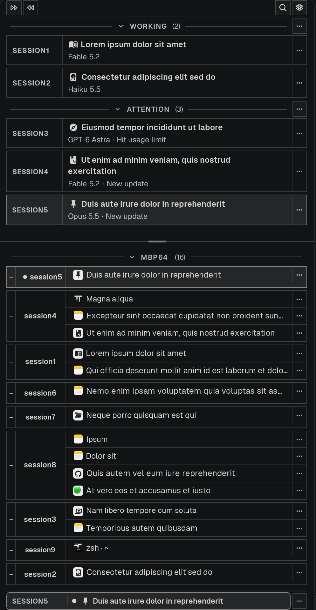

<div align="center">

# Attention

**A needs-attention rail for Tern. No bell icon required.**

[](LICENSE)


</div>

---



Clicking Tern's stock ⌘⇧I needs-attention inbox was too many clicks, so I built this! Why click many times when one click better.

- **A needs-attention view that's just there.** I keep it pinned below my panes, sticky across all windows. No clicking a bell icon to see what needs me.
- **A Workspace tab** that's pretty much the same thing as the ⌘B side window. Honestly I rarely use it — the simplicity of the attention inbox suits the monkey brain better: know what button to press next, instead of navigating sessions and tabs. That's what ⌘B is for; I keep the stock left sidebar and the attention pane at the bottom.
- **Next / Previous buttons.** I find myself using Previous more than Next.

It's factual: native runtime state and your explicit choices only. No AI inference, no prompts sent on your behalf, nothing leaves the machine. There's also a read-and-jump phone queue — your iPhone mirrors the queue from your Mac, and tapping a row jumps to that conversation.

## Install

```sh
tern plugin install github.com/baekjosh/tern-attention
```

Then choose **Attention: Enable here** in Tern's command palette. The rail mounts on the left by default (flip Settings → tabs to Horizontal and it reads as a native sidebar), and Settings still holds the default (Bottom / Right / Left); per-tab relayout lives in the palette (**Attention: Use Right in this tab**, and friends).

The full behavioral spec, the placement engine, and the proof boundaries live in [docs/REFERENCE.md](docs/REFERENCE.md).

## License

MIT — see [LICENSE](LICENSE).
