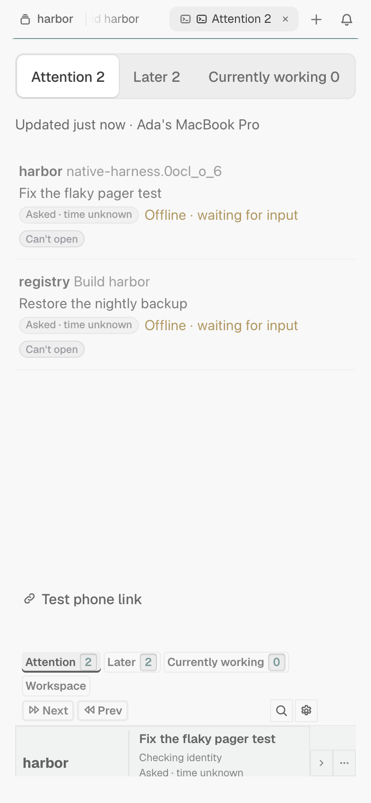

# Attention — reference

The full behavioral specification, placement engine details, native capability record, and proof boundaries. For the tour and install, see the [README](../README.md).

Attention is a [Tern](https://docs.stencil.so/tern/) plugin that answers one
question — *what needs me right now?* — without inventing anything. Every row
is native runtime state or an explicitly tracked choice; no AI inference, no
prompts sent on your behalf.

- **The Attention queue.** Current input, delivery and startup blockers, plus
  review cues — ranked, clocked, and one jump away. Jumps re-verify identity
  before focusing anything.
- **Currently working.** Every conversation whose live pane is working right
  now, independent of how you track it.
- **Workspace.** The complete native tree — every place, every session,
  parked and floating panes, saved conversations — searchable and one click
  deep.
- **Your layout, your call.** The rail sits at the bottom by default; Right
  and Left are per-tab choices, and nothing ever moves on its own.
- **A read-and-jump phone queue.** The iPhone mirrors the queue from your
  Mac; tapping jumps to the conversation. It never writes back.
- **Factual only.** Runs locally, sends nothing, and never continues an agent
  for you.

## Install

```sh
tern plugin install github.com/baekjosh/tern-attention
```

After install, choose **Attention: Enable here** in Tern's command palette.
For development installs, snapshots, and the full lifecycle contract, see
[Install and lifecycle](#install-and-lifecycle).

## Install and lifecycle (details)

From GitHub:

```sh
tern plugin install github.com/baekjosh/tern-attention
```

Or from a checkout of this repository:

```sh
python3 tools/install.py
```

The installer copies exactly twelve flat runtime files into a new producer-owned directory under `~/Library/Application Support/Tern/attention-runtime`:

- `plugin.toml`, `window.luau`, `model.luau`, `layout.luau`, `navigation.luau`
- `view.luau`, `identity.luau`, `titles.luau`, `styles.css`
- `host.luau`, `phone.luau` (the phone queue block and its shared snapshot/link module)
- `source_facts.py`

It does not copy the checkout, tests, session corpus, caches, or unrelated files. The helper belongs to that installed package, not the caller's working directory. Runtime invocation uses an absolute Python interpreter and installed helper path; this standard-library helper needs no Python package installation. There is no model, classifier client, rubric, evaluator, inference service, or optional AI enablement dependency.

Installation uses Tern's supported `tern plugin link` and confirms exact Attention link readback. The JSON report names the prepared directory, previous package, native errors, and cleanup result. After success, current and previous generations stay reachable; older activated, unmodified producer-owned generations are swept only when no plugin link references them. Earlier ten-file, nine-file, eight-file, and retired eleven-file producer-marked packages remain recognized for retention/cleanup only. Unactivated preparations, unmarked/foreign directories, modified files, unexpected additions, symlinks, and packages referenced by another plugin are preserved. Cleanup reports selected and removed file bytes and allocated blocks unlinked, not a measured increase in filesystem free space.

- `--prepare-only` creates a package and prints `readyDirectory` without linking.
- `--activate-existing READYDIR` links a complete **current twelve-file** package without recopying, and only if its ownership marker carries the current runtime capability (`workspace-navigator-2`). Ten-, nine-, eight-, and eleven-file packages, and twelve-file packages prepared before the capability marker existed, are rejected before native linking: a package without `host.luau` and `phone.luau` has no phone queue, and the runtime writes preference schema 4, which older code cannot read, so **fix forward** with a newly prepared runtime. Keeping a previous package is not a promise its code can read newer state or implement the current product, and there is no automated rollback: recovering from a bad release means preparing and activating a corrected one.
- Failed activation reports its errors and attempts cleanup only of its own new package. A linked, modified, or ambiguously reachable package remains in place; the installer does not silently switch to old code.

`"renderProof": false` is intentional: a successful install proves the link, not native rendering. Do not link the live checkout with `tern plugin link .`; source edits would then reload the running panel. Publish source changes through the snapshot installer.

The window entry loads dependencies in dependency order, one module per native timer callback, then registers the controller. Tern's native wall-time deadline includes module compilation; loading the entire graph in the entry hook can leave restored rails visible with no click handler. No native budget or concurrency setting is changed.

Steady-state cost follows change, not time: one validated preference parse per settled heartbeat, observational rail updates batched into one commit per pass (write-ahead placement checkpoints stay immediate), interactive clicks reuse their callback's inventory, queue derivations memoize per presentation, triage saves re-copy only changed entries, and phone rows are built only when presentation, workspace fingerprint or minute bucket moves. The agent census (`cx.agents:list()`, the costliest native read: 8.6 ms mean in a live window) is re-read only after an agent state or finish event, a pane appearing or closing, or 5 s of age, since model and delivery error have no event; a reused census drops agents whose pane has left. A rail skips its render when everything the render reads is unchanged (the UI state, the presentation revision, the rendered Workspace tree and the other view options, natively encoded into one key, plus a clock bucket of 10 s in view and 60 s on a hidden rail, so an age chip advances at most that late). A source re-check that finds the same availability keeps the row unchanged; the details line reads "Source availability unchanged since" that first observation, while ordering checks use the latest capture. A stored reply keeps only the 300-character excerpt the rail shows and human input keeps only its time, so a triage save is a fraction of its former size; records saved before that load bounded and are rewritten once. Dead panes drop their source bookkeeping, and identity-keyed caches stay only while a locator, retained record or in-flight request pins them. No timer, poll or retry cadence changed.

Choose **Attention: Enable here** in Tern's existing command palette after linking. Linking alone does not enable Attention. Enable here assigns the owner window; other windows do not compete to write its panes or state.

```sh
tern plugin list
tern plugin unlink attention
```

Unlink leaves the checkout and runtime packages in place. For an installation made with `tern plugin install`, use `tern plugin remove attention` instead. Link/unlink/install/remove reload plugins automatically; successful reload is not proof of native interactions.

## Modes, rail, and navigation

The rail's shape follows its placement; the views are the same three. Bottom is one region behind mode tabs. Left and right are two regions stacked in one canvas, with every queue visible at once.

**Bottom** is a single region with one toolbar. On the left: the two queues and **Workspace**. The queues keep the order you set (default **Attention**, **Currently working**; reorder from a side rail's queue menus — see Workspace below), and Workspace stays last. The queues carry conversation counts; Workspace carries its tab count (`Workspace · N tabs`). **Next attention** and **Previous** follow. At the far right are the magnifying-glass **Search workspace** button and the Settings gear. There is no New button; creation stays in the command palette. The current-location line appears only in Workspace, never in the queues or Settings. The two-region layout below does not touch it.

**Left and right** rails are a vertical split inside the Attention canvas: no mode tabs and no mode switching.

- **Top region.** A slim tools line stays pinned at the pane's top edge, with no padding above it: **Next attention** and **Previous** on the left, with **Search workspace** and the Settings gear (More) right-aligned. Under it, **Attention** and **Currently working** are two collapsible sections shown together. Each section is as tall as its rows: a header of one 28 px line with the centred title, the conversation count beside it, and a collapse toggle, and an empty section is just that header. A folded section opens by itself when a conversation arrives in it (one newly needing attention, or one that starts working), and Attention's arrival cue plays as it opens; fold it again and it stays folded until the next arrival. Every row is shown; nothing pages. A list past the rail's row budget (200 rows or 1500 canvas nodes, whichever comes first, across the whole rail) ends with the footer `N more not shown · Search reaches them`. There is no tab row; the mode-tab header exists only in the bottom rail.
- **Bottom region.** The Workspace tree, with sessions on other hosts minimized by default (see Minimized sessions below). Minimizing and restoring persist exactly as in the bottom rail, and a saved choice always wins over the default. This region's head — pinned to the pane's bottom edge, so the tree fills the space above it — is the current-location line: one line like a rail queue row, as wide as the session boxes above it: the session in the caps column, then an accent dot and the current tab (the region's name when there is no current place). Clicking the card, like the boxed − beside it (in the Settings gear's column), shows or minimizes the tree; **Reveal in Workspace** stays a command-palette action. A tab row's More menu also lists its target conversation's tracking items (the conversation the row shows: Keep as reference, Finished, Resume tracking, Bring back, Inspect) above the tab actions.
- **Divider.** A native draggable divider separates the regions; drag it to set the top region's share of the rail height. New rails start with the queues taking a third. Each region has a minimum size (about one section header plus three rows), so neither can be dragged away. The ratio you drag to is session-local and per rail: native keeps it for that tab's rail and the plugin cannot read it back, so rails in other tabs keep their own ratios; it survives redraws and tab switches, resets when the daemon restarts, and is never written to preferences. **Minimize** (the − at the Workspace head's right end) sets the share to give the queues nearly the whole rail, and **Show** restores the ratio you had. A queue that outgrows its region scrolls inside it. The Workspace list keeps the current place's box in view (the session box, or its host's Minimized group): every tab's rail scrolls itself there when the current place changes, including rails in hidden tabs, so a tab switch lands on the current session; scrolling by hand is kept until the current place moves again. **Minimize** (the − at the Workspace head's right end) shrinks the Workspace to its head and gives the queues the rest; **Show** restores the thirds.
- The split lives entirely inside the canvas. The tab's native layout, the rail's edge, and its recorded size are unchanged (see Rail placement).

The regions are depth-coded: below the divider the Workspace region renders one step recessed (a darker panel mix under a hairline lip), and its panel-tone head forms the well's rim, so the split reads as a change of depth rather than a lone line. A bottom rail is a single region and has no seam.

In both shapes the views mean the same thing:

- **Attention** is an intervention/review view. It never adds running or idle work to fill space. Empty Attention and Currently working views show nothing; Workspace states when inventory is missing.
- **Currently working** lists conversations whose live pane is currently reported as `working` by Tern. Offline, missing-pane, idle, and waiting-for-input records are excluded. Tracking disposition does not hide live work: a running conversation kept as reference or finished still appears here. Opening it is navigation only, with no acknowledgement or change to the Next-attention round.
- **Workspace** is the complete native-backed tree, described below.

**Where I left it.** The owner window's last mode (bottom rail) and its collapsed groups persist per window (preferences schema 4, `uiByWindow`, at most 32 windows kept) and are restored once when that window becomes the owner. The first activation ever starts in Attention. Restoring never replays an action, reopens a menu or picker, moves native focus, or treats saved state as fresh proof. Scroll position, Settings, expansion, search text, and the left/right divider ratio are memory-only. Unrecognized saved values fall back to Attention with nothing collapsed.

### Workspace

Workspace shows the native sidebar's hierarchy: **host › session › tab**, one row per tab, the way the native Cmd+B sidebar does. A tab's row is titled by its name when it has one, else by its focused place (the native focused pane). Panes inside a tab are reached through Search.

- A place is any native pane: conversation, note, file, browser or PDF, shell, and the other pane kinds. Notes, browsers, and shells are never tracked as tasks. Attention's own rail panes never appear (they are recognized by ownership marker, not title). A pane inside a tab is not a row; Search finds it by title.
- Host rows appear only when more than one host has something listed, as full-width disclosure rows — chevron, name, and tab count — that expand or collapse that host's world. A tab with no content place is hidden. A session with no visible tab is listed under its host's centred **No tabs (N)** disclosure (after that host's sessions; fold it with its caret, and the fold persists like a session's), each name in a small box of its own that switches to that session and opens its first tab; the names stay on one row, which scrolls sideways when it is wider than the pane. The current session keeps its own box even when empty, so its accent ring still shows where you are. Closing the last tab of the current session (⌘W, `exit`, or the tab's Close) returns to the pane you were on before, like closing a browser's last tab, because the rail lives in a tab and an empty session has none; the empty session stays listed. A tab keeps its native name, and its row follows native tab order (manual reorder drives that same order). An unnamed tab with no focused content place is titled by its first content place.
- Titles are native; a blank title, or a placeholder made only of dashes, dots, underscores, ellipses or middle dots, or a bare path such as `~` (what a new shell shows), falls back to something derived (URL host and path without credentials, file name, program and directory, kind). Titles are display only; identity is the exact native host/session/tab/pane ids, so two panes with the same title stay distinct.
- **Sessions are monochrome boxes.** Each session is a box tinted faintly from the theme's foreground, edged in the same foreground a step below the current session's ring, with more space between boxes than between the rows inside; a thin rule one step softer than that edge separates its tabs. The current session is the brightest box, ringed in the foreground colour with a dot before its name, and the current tab inside it carries one more step of the same tint. The place card at the Workspace head uses the same monochrome ring, tint and dot. No session colour or accent hue is used.
- **Every ⋯ is boxed.** Inside a box (tab rows, queue rows) it is a full-height column behind a hairline; on a header (Working, Attention) it is an outlined button like the toolbar's. They all share one column: the Settings gear's, at the rail's right edge, with the place card's −.
- Counts are tabs: a host row shows the tabs it is showing in parentheses (`STUDIO (13)`): tabs in its minimized sessions are left out, so the number changes as you minimize, restore, open and close; a minimized session shows its own count where its tabs would be. Top-level headers (Working, Attention, and each host) are labelled dividers: the ALL-CAPS label and its count in parentheses, centred between thin rules, with no band; **Minimized** and **No tabs** are the same divider at half the pane's width, centred, each marking a part of its host rather than a new one. An offline host shows last-known data without a count rather than zero.
- Per host, **Parked** and **Unattached** sections list panes that have no tab, with no invented session. Retained tracking records (no open pane, offline, unverified) are not tree rows: **Search** reaches them (and the **Attention** queue while one carries an Attention cue), and they are last-known facts, never presented as open panes.
- Markers on leaves: **Reference**, **Finished** (low emphasis), **Parked**, **Floating**, **Offline**.
- Group rows have a disclosure chevron, an activation target, and for tabs and sessions a More menu. When a tab row's target is a conversation, that menu lists its tracking items first, then **Rename tab…**, **New tab here**, **Park (keep program alive)**, and **Close** (it omits Open existing pane and Remove retained row). A tab row that owns panes on the current host offers **Park (keep program alive)** and **Close**, each applied to every pane of that tab (`Park (keep program alive) · 3 panes` when more than one). Close is destructive by design and never asks again: it is deliberate (open the menu, choose Close). Park detaches the panes to the background and keeps their programs running. A tab with no panes, a tab on another host, and every session row offer neither. Activating a Saved conversations row only reveals it; there is no pane to focus. A conversation whose pane is not open reveals its Saved conversations row with the notice `No open pane · shown in Saved conversations`. In the bottom rail the toolbar and current-location line stay pinned while the list scrolls (Tern's canvas region scrolls natively), and the Workspace mode tab carries the count; in a left or right rail the Workspace region header holds the count and the location line.
- **Leaf rows in a left or right rail** put the title, ellipsized, on one 28 px line, with a reserved muted sub-line beneath it where there is something to say. A note, browser, shell, or other non-conversation place shows its kind there. A conversation's sub-line is the agent's model (full text in the tooltip), which is display only (never part of identity, signature, search, or activation). It is shown whenever the model is known, including when every conversation leaf in the list names the same model, and absent when no model is known. The bottom strip shows the same model in its metadata row.
- **Tab rows** lead with the native sidebar's **tile**: Tern's own icon for the tab's focused place, centred on the title in a 16 px square. An omp agent shows the omp tile, a note the note tile, another file the document tile, a browser the globe, and a terminal its program's tile (vim, htop, lazygit, codex, …) or the shell tile; a canvas or plugin shows the shell tile, as native does. A tab title that starts with an icon glyph (a Nerd Font glyph or an emoji) and a space shows that glyph on the tile instead of in the label.
- **Session boxes.** The session name sits in a narrow 78 px label column (12 px, cut at the end with the full name in its tooltip) so the tab titles get the width. A session's name jumps to that session (native lands on its last-used tab); an empty session's name is plain text. The full-height **−** strip at a box's left edge minimizes the session: it leaves the host's list for that host's **Minimized (n)** group (a half-width divider above No tabs, foldable like No tabs), shrunk to one line with its tab count. There the strip is a **+** that restores it to its place; both lists keep native session order. The strips share one column and their hit area spans the gap to the next box, so pressing repeatedly without moving the pointer minimizes (or restores) one session after another as the boxes slide up.
- **Starting state in a left or right rail.** Sessions on other hosts start minimized; sessions on this Mac start in full. A session you minimize or restore keeps that choice.
- **Minimize (left and right rails).** The Workspace head sits at the bottom of the pane in both states: expanded, the tree fills the space above it. The place card and the **−** beside it both fold the pane into that head and give the queues 90% of the rail; the **+** (or the card again, in the same spot) brings the tree back above it. It changes the layout only: nothing is saved, and like the divider it is per session.

**Manual reorder** lives in the **⋯** menus; nothing else on a row is a control for it. A tab row's ⋯ offers **Move tab up / down / to top / to bottom** and **Move session up / down / to top / to bottom** for its session; a queue section's header ⋯ (left and right rails) offers **Move up / down / to top / to bottom** among the queues. Only moves that change the order are listed. Tabs move through native `order_tab` with a verified readback, so the native sidebar ends in exactly that order, and tab moves are offered only for the host this window shows; sessions and queues are Attention's own display order (native has no reorder route for either), stored in preferences and restored on reload, and the bottom strip follows the queue order set from a side rail. Parked and Unattached stay fixed, and a target that changed or vanished before the choice refuses with `Target changed`.


**Activation** is always re-resolved against a fresh inventory by exact key and signature; a changed target says `Target changed` and does nothing, never falling back to a title or an index. A tab opens its target place (its focused place, else its first content place); a tab with no target refuses with a notice. A session row switches session; a host row switches host; an offline host says so and changes nothing. A floating pane is focused where it floats. A parked pane is **never** focused or unparked (Tern would deal it into the current tab): the row refuses with a notice and opens Tern's own Parked panes chooser instead.

### Search

**Search workspace** (the magnifying-glass button at the right of the toolbar, or of the tools line in a left or right rail, or **Attention: Search workspace**) opens Tern's native picker over the **complete** inventory regardless of mode or collapse: every place, every named tab, every session including empty ones, and every saved conversation. Entries are labelled `title · tab · session` (plus the host when there is more than one or it is remote, and a final `#pane` when labels would collide). Only labels are filtered, fuzzily; detail text (kind and markers) is shown but not searched. With an empty query the picker shows at most **200** rows, so on a large workspace type to narrow. Escape does nothing and focus returns to where it was; accepting a result is navigation-only exact focus.

### New…

**Attention: New…** (command palette only; the header has no button) names where it will create (`host › session · directory`) before anything is committed: **New tab**, **New note…**, **Open file…**, **Open URL…**, **New session…**. Each effect is confirmed by reading native state back. A bare "new conversation" is not offered: starting an agent needs a prompt and directory, and Attention never sends prompts.

### Commands

Every command is in Tern's command palette:

- `Attention: Enable here`, `Attention: Open`, `Attention: Disable`, `Attention: Disable and close rails` (Disable, plus retiring every rail pane through the ordinary retirement path; plain Disable closes nothing)
- `Attention: Next attention` (⌘J, see below), `Attention: Previous pane`
- `Attention: Search workspace`, `Attention: Focus navigator`, `Attention: Reveal current`, `Attention: New…`
- `Attention: Reset placement (this tab)`, `Attention: Use Bottom / Right / Left in this tab`, `Attention: Use Bottom / Right / Left for all tabs`, `Attention: Write diagnostics`

There is no session chooser; sessions are rows in Workspace and entries in Search.

The phone queue adds no desktop command. Every desktop window claims `attention://` links (the phone queue's jump and test links) and does nothing with them, so macOS never tries to open an unknown URL scheme. The phone's own **Attention queue** command is in [On your phone](#on-your-phone).

### Navigation-only versus acknowledging opens

Only review actions clear Attention cues. **Attention-mode Open** and **Next attention** acknowledge the displayed update revision, after exact focus and fresh header confirmation. Workspace, Search, Previous, Reveal current, and opening from **Currently working** are navigation-only: they neither acknowledge anything nor advance the Next-attention round. Details and previews never acknowledge.

### Rail placement

There is one logical selected mode, Settings-open state, and expanded conversation for the loaded owner VM. Every physical Attention canvas follows it, so a mode chosen in one native tab survives switching tabs, sessions, and hosts. Each canvas has its own renderer epoch, click-token namespace, accepted bindings, diff cache, and arrival animation. The active rail paints first; at most one eligible background rail catches up per pass in round-robin order, without an arrival pulse; the rest follow one per 32 ms timer that paints from that pass's data (no new inventory or reconcile), and a pass that lands first supersedes it. Catch-up yields when the pass has spent 25 ms or a native budget pause was reported recently, and backs off after rejected paints. It changes canvas content only—never tab placement or focus.

**Placement is Settings plus per-tab choices.** The Settings row ("Rail placement") is the all-tabs move: pressing Bottom / Right / Left sets the global default ("Default for new tabs") and marks every eligible rail to move there. The current tab's rail starts moving at once; each other marked tab's rail moves on its first eligible visit (selected and unzoomed, host connected, rail settled). A rail that is hidden, parked, floating, or not open in this tab stays where it is, and a rail on a disconnected host is marked like any other. The toast reads, in order: `This tab moves now` (once this tab's move has started), `N tabs move on their next visit` (singular `1 tab moves`), then `left as they are: N hidden, N parked or floating, N not open in this tab`. It is the same path as the palette action **Attention: Use Bottom / Right / Left for all tabs**. Per-tab relayout lives in the command palette: **Attention: Use Bottom / Right / Left in this tab** moves only the current tab's rail; **Attention: Reset placement (this tab)** re-places it where it is. **Nothing else relocates automatically**: ordinary updates, reload, and upgrades never move a rail, and a rail already installed at an edge is adopted where it physically sits.

- A rail mounts on the first visit to a content tab as an outer child of the tab's layout at its position: the second child of a full-width `down` split (Bottom), the second child of a `right` split (Right), or the first child of a `right` split (Left), beside all content. Tern's `move` splits only a single target pane, so the engine reconstructs the layout with (content leaves − 1) bounded moves and then restores content split ratios; content identities, order, floats, and native focus are preserved. Beyond 16 content panes the rail stays beside the first pane only, and the status says so. Whole-cell rounding and native minimum sizes may limit the requested size, which is reported rather than hidden. An unrelated user layout edit interrupts placement rather than being overwritten repeatedly.
- The rail size is one fraction of the tab per position and host (`defaults.shares[position][host]`, default 0.25). It is recorded from where the rail physically is once a divider drag or a native move settles, and at adoption when none is stored yet, so every tab on that host at that position shares it. **Reset placement** re-places this tab's rail at its current position; manual moves, splits, floating, and parking are otherwise respected, and ordinary updates and reload never force an outer rail.
- **Two regions inside the rail.** The left/right two-region layout (see Modes, rail, and navigation) is a split inside the Attention canvas, not part of the tab's native layout. Placement, the rail's root, its recorded size, and every rule above are identical for Bottom, Right, and Left. Dragging the native divider between the rail and the content still records the rail size; dragging the divider inside the rail does not, and its ratio is session-local. A bottom rail is a single region and is unaffected.
- When the native minimum pane size (about 93 px) prevents preserving every content split ratio or the requested rail size (for example five panes side by side at 700 px), Attention is still placed at its chosen edge with the rail at least 20% of the tab where achievable, content panes shrink to the native minimum, and the status reads "Pane sizes limited by the native minimum". **Reset placement** remains available.
- **Adoption and migration.** Preferences are **schema 4**: `defaults.position` (new rails), `defaults.shares[position][host]` (one size per position and host, default 0.25), per-instance `position`, `queueOrder` (a permutation of the two queue names, default attention/working; a stored order that still names the retired Later queue loses it on load, and anything else that is not a permutation falls back to the default), and `sessionOrder` (host key → that host's session ids; at most 64 hosts, 256 sessions per host, 1024 ids total — ids with no live session are ignored on read). Per-instance `share` and `shares` tables, the left-only `defaults.share` map, and the retired `backlogAfterSeconds` age-to-Later setting are dropped on load; a rail's size is its physical layout: adoption records the first adopted width for each host and position when none is stored, and a drag or native move records it again once it settles. An instance saved without a `position` is adopted at the edge its rail physically occupies (the default when it was never mounted) and is never moved. The obsolete `relocate` flag from the left-only build is stripped on load. Schema 2 and 3 migrate to 4 once, idempotently, stores from before the order fields existed acquire the defaults, and in-flight placement checkpoints from older versions are dropped, never replayed; a newer schema is read-only and never downgraded. A rail you parked, floated, or moved elsewhere is kept exactly as found and reported.
- Closing Attention hides it only in that tab, including after reload; it does not clear work or disable the owner window. A blank leftover pane that never displayed Attention since plugin load is recovered rather than read as a deliberate hide. **Attention: Open** reuses or recovers the current tab's pane, including a hidden or parked one. **Attention: Disable** disables the owner window globally.
- Closing the last content pane retires that tab's owned canvas, not retained conversation records, inside the native close event: the rail never stays behind filling an emptied tab, and the tab closes as it would without Attention. Confirmed tab closure removes its registry entry; sustained absence of both content and Attention from connected-host inventory (about 30 seconds) also retires it. Missing inventory is unknown, not a request to hide.
- A tab created while the window is open (New tab, New session, Attention's own New…) gets its rail inside its creation events, before the first keystroke. The two-second restore grace applies only to tabs that existed before the window loaded, whose canvases may still be replicating.
- A blank restored canvas after a daemon restart is replaced only after positive host-side capture, same-tab membership, connected-host and visibility checks. The old pane is closed only after replacement ownership is confirmed.

Focusing Attention keeps the sidebar/native canvas title tied to the tab's last content pane, including subsequent title changes. Explicit tab names are not rewritten. Tern 0.9.8's vertical sidebar ignores `tern.chrome.tab_title`, so the implementation updates only the owned canvas's native title, within the native 80-character UTF-8 limit. This title-selection memory is separate from global panel selection and reseeds from native content focus on reload. Preference schema 4 preserves enabled state, ownership, suppression, and per-position rail size defaults.

### One control window and native recovery

Exactly one window owns the rail. Other windows keep Tern's native navigation; **Attention: Enable here** transfers ownership explicitly, and there is no automatic election. Enabling can take a window that has no content yet and then reports that no rail is mounted, so use native navigation.

Recovery never depends on this plugin. The plugin **never writes native visibility settings** (such as `tabs_autohide`): hiding Tern's own sidebar is something you do. If you do, Tern's own routes bring navigation back with the plugin absent, disabled, or paused:

- The native **View** menu (Show Sidebar) and the command palette. `toggle_sidebar` works with vertical tabs and switches the sidebar to an autohide edge strip; hovering the left edge slides out sessions, tabs, and a filter. ⌘B is a convenience only: other actions (`git.new_branch`, `markdown.bold`, …) can take precedence in some contexts, so rely on the menu or palette.
- The palette's `switch_session`, `switch_host`, `new_tab`, `new_session`, `new_note`, and `focus_tabs` work in every context, including an empty session; `parked_panes` appears when parked panes exist.

Whether `tabs_autohide` is global or per window, and whether hiding it in the control window affects other windows, was not exercised (see the native capability record).

## Inventory and attention

**Workspace** lists every native place once, and conversations among them carry their tracking state. Tracked conversations are every freshly eligible exact OMP conversation plus explicitly retained records with no open pane; a retained record with no live route is not a tree row (Search reaches it). Quiet and working conversations remain visible there even without attention. Shells, documents, and Attention canvases are not tasks. Proven duplicate bindings share one work record; titles, working directories, or similar paths are not identity proof, and two conversations sharing a title never merge.

**Attention** is an intervention/review queue: current native input, delivery, and startup blockers, plus unsuperseded review, manual-revisit, or recorded-question cues on nonworking conversations. Ordinary **Working** conversations stay in Workspace, not Attention, its counts, or Next attention. A current blocker is named as that blocker rather than displayed as Working.

A turn that ended on a usage or rate limit stays in Attention while its reset is unknown (`Hit usage limit`). While omp says every account of that provider is blocked, it rests out of Attention, folded under **Waiting on reset (N)** at the bottom of the Attention section (closed until opened, stacked rails only), reading `Usage limit · back in 2h`. When the reset passes it returns to Attention by itself, with the arrival pulse, reading `Usage limit · reset due` (omp's deadline passed; the provider may still refuse, so a reset is never claimed); nothing is resent for you.

Resuming work supersedes older passive Attention cues without acknowledging their unread update revision or erasing recorded questions/results. Idle alone, unchanged native alerts, reload, and older completion callbacks do not revive them. A genuinely new settled update or completion can create review again; a current-turn completion arriving before native Working catches up stays recorded but hidden until settled. Newly qualified recorded questions have independent cue causality: they can become actionable without reviving an older reply review or pretending native runtime is Waiting. Runtime, replies, question outcomes, and explicit disposition remain independent: neither a final reply nor idle establishes project completion, and recorded request age is not continuous human-blocked time.

Queue badges count **tracked conversations**, not questions, panes, or a claim to complete remote inventory. An offline laptop does not add question marks to Attention or block local navigation. Native coverage remains independently qualified in the model and diagnostics; per-session availability and each conversation's offline route remain factual. An attached unhealthy host keeps its last healthy coverage briefly (up to eight seconds) before becoming offline. Offline and missing are different: a temporarily disconnected retained record is not removable merely because its route cannot be checked.

Routine coverage, offline-host, and aggregate source-status lines are omitted from the panel. Per-conversation evidence remains; loading, unsaved changes, unavailable conversation state, and actionable errors still surface. Source-helper failures remain available in explicit diagnostic readback rather than a persistent summary line.

### Priority, disposition, and closure

Priority is optional user metadata: **P0 Now**, **P1 Next**, **P2 Planned**, **P3 Optional**, or unset. Unset is normal. Priority is never inferred from age or legacy P0 inbox membership. Attention orders explicit priorities first, then unset; within a priority, native blockers precede passive review, followed by stable queue order/serial ties. The visible list and Next attention use that order. Workspace keeps native host and tab ordering and the session order you set (see Manual reorder). Priority changes affect the **next** Next-attention round, not the identity of an already selected target.

The row menu uses native pickers/prompts for Bring back now (on a reference or finished row), priority, Keep as reference, Finished for now, Resume tracking, and removal of a retained row without a live pane. Cancellation, invalid input, or a stale target is nonmutating. There is no actor/next-move classification or manual correction board. Resume tracking never sends anything to an agent.

- **Bring back now** creates a manual revisit cue; it does not manufacture a source completion timestamp or reset source ages.
- Reference and Finished for now describe explicit tracking intent, not acceptance of an implementation or termination of a process. They remain until **explicit Resume tracking**. No source-text classification, new message, background activity, or inferred new scope automatically reactivates them.
- Reference and explicitly finished records are retained after their last pane closes. They show **No open pane**, do not fabricate a route, and never launch another agent. Remove retained row deletes only that compact tracking record, not a conversation or session.
- Ordinary unpinned live-only work retires after its last confirmed binding closes, without asserting completion. Closing one duplicate binding leaves the surviving exact route intact. Rediscovery must not replay already acknowledged updates as new.

### Open, Next attention, and Previous

**Open** navigates only after fresh exact identity/location checks. **Next attention** traverses navigable Attention targets globally, even while the panel stays on another mode or Settings. New arrivals and rank changes join the next traversal round; surviving targets are not repeatedly visited before the current round finishes. Unavailable routes are skipped. Disclosure expands the same stable work item globally without navigation or acknowledgment.

Successful Open/Next acknowledges only the displayed/selected **update revision**, after native focus is confirmed at the exact target. A newer update racing navigation remains new and does not consume the captured traversal turn. Failed, cancelled, and expired visits do not advance the round. This does not answer a question, resolve a checkpoint, prove reading, accept a result, mark work finished, or reset source clocks. An attributable confirmed direct reply can acknowledge the revision it actually responded to; synthetic role-user controls cannot. Live conditions remain until directly observed to resolve; source questions retain their own answer/cancellation state.

A newer content-pane selection cancels an Open/Next-attention jump that is still awaiting its first focus write. Abandoned navigation neither acknowledges the displayed revision nor consumes its traversal turn. Expected controller-owned focus and subsequent exact-target confirmation remain separate; unrelated agent activity does not cancel a requested jump.

Explicit queue, Settings, or disclosure changes invalidate a captured asynchronous action, including an away-and-back selection. Unrelated automatic arrivals, removals, and anchor changes do not: accepted navigation and menu/date confirmations retain their exact target and explicit selection intent. Changed conversation identity, membership, header, or captured menu facts still reject the action.

The accepted row shows its actual stage: **Waiting…** for the interactive lane, **Checking…** for identity/header verification, **Opening…** for activation, and **Confirming…** for exact native focus and the separate fresh acknowledgment header. Its Open action is temporarily unavailable; **Cancel** abandons that exact request without acknowledging or advancing the round, even after focus has moved. It does not undo focus or claim to kill an active helper. Other rows, disclosure, and menus remain usable. Repeating the same pending action shares that navigation; a different target supersedes it without discarding independent menu/date work.

Open/Next header checks have a dedicated finite lane, so an unrelated transcript read or queued date action cannot hold them up. Each owning controller VM permits one interactive header child and one ordinary source/action child; retired owners' finite children may finish, but cannot act on the new owner. No new background source body starts during an accepted navigation. Each accepted request has a **10-second total deadline**, including queue, identity, header, and confirmation time. Budget interruption abandons it; a discarded callback cannot orphan its request ownership. Deadline checks reject late work when the host resumes delivery—this does not promise a repaint while Tern itself has paused callbacks.

**Previous** is the toolbar rewind control and the **Attention: Previous pane** palette command, with no automatic shortcut. It returns through ordered distinct content-pane focus changes in the owner window regardless of whether a jump came from a native notification, Open/Next attention, a Workspace row, Search, or manual focus. A→B→C rewinds to B, then A, then reports no previous pane. A new jump pushes again; nonconsecutive A→B→A transitions remain distinct. There is no Forward button. Attention panes are neither departures nor destinations; focusing Attention keeps the last content target. Closed destinations are pruned, exact membership is rechecked, and unavailable navigation never falls back to a different pane. Previous is navigation-only.

Mode buttons switch what the rail shows and never filter the native session or move focus. The gear toggles shared Settings (the placement **Default for new tabs**) and returns to the prior mode and detail; mode buttons explicitly leave Settings. While Settings is open, the gear reads **Back to** plus the queue it returns to (for example `Back to Attention`), and the Settings heading carries the same Back control, so the way out is named where you look. Next attention and Previous remain available there. Native picker results (Search, New…, menus) are revalidated when they complete.

Attention's occupied-list accent band is a queue cue, not an unread marker. Eligible arrivals may produce one bounded wash in the active visible Attention view; hidden, rate-limited, initial/reload, navigation, and catch-up arrivals do not replay. Reduce Motion keeps the steady band without a pulse. Age ticks, counts, and enrichment do not steal focus, reorder native panes, or change the selected section deliberately.

## Recorded source facts and clocks

Fresh native inventory owns current runtime and location. Exact local locators from native inspection identify finite read-only `source_facts.py` requests; the helper verifies the source header UUID and qualified supported record shapes. Remote locators are not silently read as local files. Pane reuse, a replaced header at the same path, forks, and similar names cannot inherit another conversation's acknowledgments or disposition.

The helper replays the **persisted** selected branch (`activeLeafId`, including explicit null and supported missing-marker rules), labelled **disk-replayed**. It does not prove the producer's live in-memory branch. A later appended off-branch event is not automatically the current result. Changed sources are rebuilt canonically; this is not an append-only history index or an archive scan. Metadata-only unchanged observations can reuse accepted facts without rereading bodies; that observation is not proof against arbitrary undetectable mutation. Partial lines, malformed/unsupported records, missing files, branch problems, and incomplete context report coverage limits instead of pretending the source is complete. One unhealthy source does not erase another's useful facts.

Freshness has separate clocks. A current-owner metadata observation can establish when the file was just checked; reusing a previously accepted source body does not advance its capture or event timestamps. Only reusable results supply an unchanged cursor. An incomplete scan with no usable selected-body replay preserves last-known source/native facts rather than replacing them with an empty current history. Neither a recent stat nor a recent helper callback makes an old recorded reply new.

Full source replay has a 1 GiB source-byte ceiling, 200,000-entry ceiling, 8 MiB record ceiling, and six-second per-target deadline. The controller processes one target per helper call with an eight-second outer timeout; ordinary queued date/header actions run before the next source target. Open/Next's pre-focus and post-focus header proofs instead use the dedicated interactive lane, with a three-second outer timeout each. An `op: "header"` request reads at most 64 KiB/eight records within one second per target. Header proof establishes identity, not complete selected history, question resolution, or semantic coverage. Unknown/historical writer shapes remain partial rather than silently complete. Known synthetic controls and automatic ask timeouts are not attributable human input or answers.

Top-level `questionCoverage` reports complete/bounded/unknown excerpt status with known-total, included, omitted, and independently disclosed text truncation. `questionOutcomes` separately carries compact positive outcomes for omitted attempts within the existing 512-attempt tracking bound; `outcomeIncluded`, `outcomeOmitted`, and `trackingOmitted` disclose delivery limits. Qualified outcomes update exact retained question IDs without replacing their original text or inferring an answer from absence. Bounded/unknown coverage preserves qualified last-known question identities/outcomes; fully qualified complete selected history retains its branch-replacement authority. Automatic timed-out selections record automatic provenance/resolution time, never a human response clock; valid manual structured answers can update recorded human interaction.

Observed excerpts from an older, unqualified writer remain inspectable with incomplete/unknown selection coverage and last-known clock labels. They are not current branch authority: they cannot create a new question obligation or settle a previously qualified question. Missing/metadata-only history remains distinct from these usable but qualified observations.

Active tracking preserves a bounded last-qualified question baseline and the observed work cutoff across source-read gaps. After complete qualified recovery, a new open attempt asked after both boundaries can become actionable once without reviving an older reply review. Initial historical backfill, unqualified/bounded evidence, old attempts, and reference/finished exclusions cannot use this recovery path.

Clocks remain separate and source-qualified:

- Final reply age uses supported successful human-facing completion and `completedAt`; a fallback envelope time is **recorded**, not exact completion. Tool-use text reporting an artifact is a delivery claim, not an independently validated final or proof that the whole task is done.
- Question age belongs to the exact recorded question attempt, not a guessed moment the user saw it. Batched questions resolve independently; answers, valid empty selections, cancellation, and generic failures are distinct. A cancelled popup does not prove the underlying decision answered; similar reissued wording does not prove shared identity. A raw provider call ID reused in a later assistant entry starts a separate attempt; its answer cannot overwrite or strand the earlier attempt.
- Human interaction uses attributable user input or supported structured answers. Synthetic role-user messages do not reset this clock. Unrelated input does not resolve sibling questions.
- Focus/ack is a local observation from now on, never historical read telemetry. Quiet/idle time and reused background labels do not establish job duration or continuous human-blocked time.
- UTC is persisted; local timezone is for display. Unknown/skewed/future times remain uncertain rather than zero or negative ages. Sleep/reload recomputes displayed age without restarting source clocks.

**Rows.** A bottom strip row is two lines. The **session** is a bold column spanning both lines (ellipsized, 12–16 characters wide, with a divider), so you scan the session first; the title and any nonredundant parenthesized review description sit on line one, and line two carries the event clock and the full current state. It has a disclosure chevron and a More button beside the row.

A queue row (Attention, Currently working) in a left or right rail is two lines, about 36 px tall, or three when its title wraps:

- The **session** is the first column, in capitals, in a fixed 88 px cell spanning both lines. A long session name is truncated, with the full name in the tooltip, so the column lines up down the rail.
- The **title** takes the width and wraps to at most two lines, ending in an ellipsis past that. Every title elsewhere (Workspace rows, the place card, chips) stays on one line and is cut at its end, never in the middle. Only the **priority chip** (`P0`–`P3`) sits right-aligned after it.
- Line two reads **model · need** in muted text, on one line: `Opus 5.5 · Reply to review`. It carries no age; the clock's full sentence stays in the row tooltip. The model is the agent's model; the **need** is what the row needs from you (`Waiting for input`, `Asks: …`, `Prompt not delivered`, `Hit usage limit`, `Usage limit · reset due`, `Hit rate limit`, `API error`, `Reply to review`, `Last known: …` when offline), worded by the model, full text in its tooltip. A narrow rail cuts the need first, then the model. A part that is unknown is left out with its separator. An ordinary Working row says nothing in the need slot (it already sits under Currently working). What its agent waits on decides the rest: a tool running past a minute is named (**Running eval 4m**, **Waiting on jobs 20m** for `wait`) and reads **Stalled · Running bash 1h** only past an hour; a model call is quiet until 15 minutes without a reply, then **Stalled 16m**. With nothing known in flight it never claims a stall. (Bounds from a month of omp sessions: model calls reach 13.9 minutes at p99.9, `wait` runs to its 30-minute cap.) Every queue row reserves the line, so rows stay aligned. Workspace leaf rows keep their state marker on line one instead (**Waiting**, **Undelivered**, **Failed**, **Exited**, **Unknown**, **Offline**).
- **Each row is a box**, like a Workspace session box: an outline, the session column and the lines as full-height cells divided by hairlines, and the More button (⋯) as its own full-height column at the right. The conversation in the focused pane takes the current session box's ring and tint, here as in the Workspace.
- **Triage lives in the row menu.** The More column opens it: priority, Reference, Finished, and **Inspect recorded facts**. There is no inline triage button and no disclosure chevron on a rail row; the recorded facts, once opened, carry their own **Hide recorded facts** button.
- Everything the rows leave out (host, reason, context, the full state sentence, the clock's full sentence, the priority name) is in the row's tooltip.
- Workspace leaf rows have a reserved muted **sub-line** (see Workspace).

The layout follows the rail's placement, never the viewport. Conversation rows in every mode expose explicit Reference and Finished tracking intent independently of runtime. Row buttons are sized to their content so a narrow rail truncates instead of overlapping. Every queue and the Workspace list show every row; the list scrolls, and past the 200-row canvas budget the footer says how many are not shown. The disclosure chevron (bottom strip) or **Inspect recorded facts** (rail) inspects recorded facts without navigating or acknowledging; it puts the relevant request/reply first, tracking next, and source identifiers, acquisition clocks, coverage, and provenance below. Reopening a closed conversation is not offered: the menu offers **Inspect recorded facts** and, when a pane is still open, **Open existing pane** (see the native capability record).

The summary clock says when the **agent** last acted, in short words: **Asked 12m ago** (an open question), **Replied 3d ago** (the last reply), **Updated 5m ago** (the last assistant update). A time that is only *recorded* — the row is offline, its source has not been read in this run, or its source cannot be read right now — renders as a muted, dashed chip with a hollow marker, **≈ Asked 12m ago**; a live, readable row keeps the plain solid chip, so the difference shows without reading any text. Its tooltip gives the full sentence (`The agent last asked a question 12 minutes ago.`), says when the reply was only recorded rather than established as completed, and says why the time is recorded (`Offline: this is the last recorded time.` / `The source cannot be read right now, so this is the last recorded time.`). An unusable time reads `Asked · time unknown`. In the bottom strip the state word stays short (**Waiting for input**, **Idle**, **Working**); a row whose native state cannot be refreshed because its host or pane is offline reads `Offline · waiting for input` with a tooltip, so staleness is never hidden. A rail queue row shows no clock: the full sentence and the full state are in its tooltip. Ordinary Working and superseded passive cues do not borrow an old reply clock or imply a working duration. Shared detail retains exact recorded times, excerpts, runtime, provenance, per-question outcomes, and coverage. Historical enrichment cannot manufacture an unread flood, correlate native turns merely by time/text, or undo newer local acknowledgment.

### Persistence and failure behavior

One canonical `triage` KV store uses **schema 3**; the navigator's own state lives separately in the plugin's preferences (schema 4, above), and rail placement did not change the triage schema or any tracking record. Schemas 1 and 2 migrate idempotently, preserving acknowledgment/deduplication, stable serial/order, explicit tracking intent, quiet cursors, and legacy aging evidence. Old P0 becomes Attention membership with priority unset; Backlog becomes **Finished for now**, retained. A schema-3 record set aside in the retired Later queue loads as **Finished for now**, retained, with its return date, civil time, zone, and Later baselines dropped; the store is rewritten once. Optional persisted review/source-question supersession keeps resumed work quiet across reload without clearing unread revision evidence; existing schema-3 Working records acquire that state on load. There is no second task database or parallel legacy writer. Compact factual source state and explicit tracking intent persist together with causal cursors, not full transcripts or inference caches. Obsolete derived inference fields are dropped without rejecting user/source/triage data. VM-relative runtime clocks are not persisted as UTC. Tern's KV write replaces the whole store through a same-directory temporary file and rename (110 forced-kill trials left no corrupt file); power-loss durability is unproven.

Unreadable/invalid saved state remains untouched and is reported, not overwritten by an empty queue. Failed saves keep live work visible with an unsaved warning and retry; they do not turn exact counts into unknown. Unchanged state is not rewritten. Owner/renderer/source epochs reject late callbacks. A pass-wide failure paints an explicit paused status rather than leaving stale content looking current; non-owner windows identify the owning-window boundary. Local source failure degrades enrichment while native inventory and qualified last-known facts remain useful.

Native inspection is bounded asynchronous `tern inspect --json --window KEY`, with exact per-pane membership and identity checks. GUI Tern resolves an absolute executable (the application bundle first, then absolute PATH entries), not a bare cwd-dependent command. Inspection runs on startup and relevant changes, with a three-second deadline and capped retry backoff (two seconds up to sixty). Ordinary source/header/date operations share one finite Python slot; navigation header proofs use the separate bounded lane above. Dirty work is coalesced with thirty-second metadata reconciliation, not source work each heartbeat. One batched native inspection precedes replay. Current-owner source observations/headers start empty each owner epoch rather than hydrating old observation proof, and visible known facts do not blink away during refresh.

Identity callbacks recheck their request generation after refreshing native membership, because that refresh can expire the same request. A successful child result delivered too late cannot persist a conversation binding; the existing bounded retry must establish a current proof first.

Native conditions are aggregated once per canonical conversation, preserving duplicate-route precedence. Each render pass reuses read-only layout observations and one navigation-status projection; layout mutations invalidate those observations, and no cache survives into the next pass. Identity completion reconciles once with the accepted proof and event batch; events for still-unverified bindings remain deferred. Background catch-up checks its budget before preparing candidate views.

## Source helper commands

The helper is a finite standard-library JSON-stdin/JSON-stdout program with no discovery, source writes, network/model calls, or child processes. Supply one protocol-1 request file from the checkout:

```sh
python3 source_facts.py < request.json
```

A source request contains `protocol: 1`, string `requestId`, current UTC epoch **seconds** in `nowUtc`, and `targets`: each has the exact `key`, absolute local `path` from fresh native inspection, and optionally `expectedSessionId` and a reusable `previousRevision`. Results preserve ready/partial/missing/unsupported/malformed/unchanged status, factual excerpts, selected branch, observations, questionCoverage, questionOutcomes, and source coverage. The transform identity `omp-facts-v5` invalidates older projections (v5 adds `lastError.provider` and, for a usage or rate limit, `lastError.limit` from omp's own account store (`<agent>/agent.db`, opened read-only with a 250 ms lock wait): `{status = "blocked", untilUtc}` while every enabled account of that provider holds a live block (until the first frees), otherwise absent: no block is not a reset; omp blocks an account when it hits a limit, ends a turn on that error only when no sibling is free, and deletes blocks as they expire; v3 added per-field coverage, `coverage.fields = {clock, questions}`, plus `lastError` and `lastActivityAtUtc`; v4 adds `inFlight`: the tool call started without a result, `{kind = "tool", tool, count, sinceUtc}`, else `{kind = "model", sinceUtc}` since the prompt or tool result that started the model call, absent after a finished turn). There is no generative-input/semantic-hash payload.

For tiny identity-only checks, add `op: "header"` to the same request shape, without a history cursor. Header results carry `historyRead: false`; a known UUID mismatch returns changed with the actual UUID and cancels the originating action rather than retargeting it. A fresh exact connected local binding may offer retryable Open/Next while awaiting this header check, but it is not counted as verified reachable and cannot acknowledge until the proof succeeds. Identity-pending/rejected, replaced, mismatched, ambiguous, orphaned, and offline targets do not gain this route.

For an installed-package check, invoke the absolute interpreter and package's absolute helper path from outside the checkout. Do not substitute a lookalike path, full corpus copy, or restored source body. Source operations remain bounded by the limits above.

## No AI runtime

The user explicitly chose factual-only tracking. The experimental classifier, its controls, policy assets, evaluator, and inference caches are removed—not shipped disabled or exposed as an optional fallback. Attention makes no inference HTTP requests and requires no Ollama/model installation or qualification. Existing stored models and the maintained service are left untouched. Historical trial evidence records a witnessed tooling failure, not current product capability or an enablement path.

## Next attention shortcut

The public action remains `plugin.attention.next`, now labelled **Attention: Next attention**. Its sole automatic default is **⌘J** (`cmd+j`), with no fallback chord. Initialization checks the effective keymap, preserves unrelated actions and sequences, recognizes an existing binding to the same action, and advertises the shortcut only after confirming it. If unavailable, the toolbar and palette still work. Previous has no automatic binding.

To choose another chord, merge rather than replace entries in Tern's `settings.json`:

```json
{
  "keybinds": {
    "cmd+alt+shift+j": "plugin.attention.next"
  }
}
```

User bindings take precedence. `"cmd+j": "unbind"` suppresses the automatic chord. The tooltip describes the Cmd+J binding recognized at initialization, not every user override. See Tern's [Commands, Keys, and Overrides](https://docs.stencil.so/tern/guides/commands.md).

## On your phone



**What you get.** Attention and Currently working as a native block on the iPhone. Each row shows its session, title, clock, and runtime state; tapping jumps to the conversation. It is read and jump only. The host-rendered view updates from the Mac, so adding this mode does not require another phone-package installation.

**How it works**

1. The owner window on your Mac writes `phone.json` (a bounded snapshot of the queue, at most 60 rows) into the plugin's data folder when the queue changes and at least every 30 seconds as a heartbeat.
2. The plugin's Mac **host block** `Attention queue` reads that file every 2 seconds and renders it. Tern on the iPhone mirrors host blocks from the Mac, so no plugin code runs for the list itself.
3. A block cannot focus a pane. A tap asks Tern to open an `attention://jump?...` link carrying the pane id, its title, and when known its working directory, program, and session name.
4. The small **Attention phone** package you install on the phone (a window half only) claims that link, finds the pane by that evidence, and focuses it.
5. The phone never writes to your Mac: it reads the snapshot and moves its own focus.

**Setup and upgrade** (the Mac plugin must already be installed and enabled with **Attention: Enable here**; the phone attaches to that Mac host)

1. On the Mac: `python3 tools/phone_package.py build`. It writes `dist/attention-phone-<version>.zip`.
2. Send or copy the zip to the iPhone: Taildrop with `python3 tools/phone_package.py send --to <name> --yes` (without `--yes` it only prints the `tailscale file cp` command), or AirDrop.
3. On the iPhone, unzip it in Files.
4. Move the `attention-phone` folder into Files › On My iPhone › Tern › Plugins. `plugin.toml` must sit directly inside that folder. **Upgrading from 0.1.0:** replace the old `attention-phone` folder there (delete it first so no old file stays; the plugin id changed from `attention-phone` to `attention`, the folder name did not).
5. In Tern on the phone, choose **Reload plugins**.
6. While viewing your Mac host, open the command palette and choose **Attention queue**. It opens the block in a tab (or focuses the one that is already open); if the host lacks the block it says `This host has no Attention queue block`.
7. First-run check: tap **Test phone link**. Expect the toast `Attention phone link works`. That proves the whole path from the block to the phone's link handler.

**Rows and what they say**

- A row can be opened only when it names an open tiled or floating pane whose route the desktop can open (not stale or unverified) **and** the pane has a native title, because the phone finds the pane by that title (the working directory, program, and session name ride along in the link when the pane has them and the link still fits in 1500 bytes). The snapshot's `jumpable` flag requires that, the link agrees (no link means not jumpable), and the reader downgrades any row whose flag claims more than its evidence supports. Saved, offline, no-open-pane, and parked conversations, and rows whose route is not openable, show a chip (`Parked`, `Offline`, `No open pane`, `Can't open`) and a tap explains why instead of jumping. An open pane whose title is blank shows the chip `Open from tab list` at normal contrast (it is not dimmed like an offline row); a tap toasts `This conversation has no title to match on your phone. Open it from the tab list.`
- Icon glyphs (Nerd Font and other private-use characters, the icon prefix some pane titles carry) are removed from the session, tab, title, and Mac name the block shows, because an iPhone without that font draws them as empty boxes. A title that is only glyphs falls back to `Untitled conversation`, and a session that is only glyphs to `Conversation`. The pane's own title, folder, program, and the session name are never altered in the jump link: it carries them byte for byte, and the phone strips the glyphs itself when it compares.
- Phone queue labels use plain system-sans elements with ordinary wrapping instead of native fitted text spans. This avoids the text-fitting path implicated by the iPhone's missing-letter screenshot; desktop-native rendering is verified, but the repaired rendering still needs observation on the real iPhone.
- Rows, the two queue controls, and the Test phone link button are at least 44 px tall.
- The clock chip uses the desktop's wording (`Asked 12m ago`, `Replied 3d ago`, `Updated 5m ago`); `≈` marks a time taken from a record rather than a source that can be read now.
- Reference and Finished records are in no queue on the Mac, and appear in Currently working here only while a live pane is working; this does not resume tracking. Counts are full totals even when the snapshot's combined row list is capped at 60.

**Truthfulness states**

- **Stale:** when the snapshot is older than 2 minutes the status line becomes `Your Mac hasn't updated this for 5m` (with the real age). Rows stay, but the warning means they may be out of date. A Mac that is asleep, offline, or has quit Tern ends up here.
- **Disabled:** `Attention is disabled on your Mac` (the owner window was disabled). It is written once, so after 2 minutes it reads as stale.
- **Unavailable:** `Attention is unavailable on your Mac: <reason>` when saved attention or the native inventory cannot be read; no rows are shown.
- **Waiting:** `Waiting for your Mac's Attention window` before any snapshot exists. A snapshot that cannot be read twice in a row says so and keeps showing the last good one with its age.
- Empty sections show nothing, not a filler sentence.

**Jumping.** A jump is navigation only: it never acknowledges a review cue, never sets aside or finishes anything, and never unparks a parked pane (focusing one would deal it into the current tab). If the matching pane is parked on the phone you get a toast instead.

**The matching rule.** A conversation always has a title, so the title is the evidence: the phone considers the panes whose title equals the link's title after both are normalized (private-use icon glyphs removed, whitespace collapsed and trimmed, case kept), never the queue block itself. One such pane is focused. Several are narrowed by the pane id modulo 2^44 (Tern packs a remote pane id as `slot << 44 | daemon id`), then by the working directory, then by the program (each only when both sides know the value and at least one pane agrees); if still several the toast is `Several panes match — open it from the tab list`. The id, working directory, and program never select a pane on their own, and the host name travels in the link but is not compared. If no pane has the title and the link names a session (`s=`) of this window other than the current one (preferring the session on the link's host, then the queue block's host; it must be unambiguous), the phone switches to it and looks again, up to three more times 300 ms apart, before toasting `Couldn't find that conversation on this phone` with `Run Attention: Copy phone diagnostics` underneath. A newer tap replaces a jump that is still looking. A parked match is reported, never unparked. After focusing, the phone reads its focus back and reports `Couldn't switch to that conversation` on a mismatch. A conversation whose pane has no native title has nothing to match, so it is never offered as a jump: its row shows `Open from tab list`.

**Diagnostics.** The palette command **Attention: Copy phone diagnostics** copies a plain-text report of at most 8 KB: package version, the phone's OS, the hosts and sessions it sees, pane counts per host slot, up to 60 panes (slot, id, kind, block, title with icon glyphs shown as `\uXXXX`, working directory, program, tab, parked/floating; the ones closest to the last tapped title first), and what the last tap looked for with the number of candidates left after each matching step. Every string is cut at 120 characters.

**What the phone does not do.** Reference, finish, acknowledge, settings, Workspace, Search, rail placement, and New… stay on the Mac. The phone package is a window half only: no processes, no network, and no host entry.

**Evidence and limits.** The user's iPhone recording confirms that the queue renders real rows and a row tap reaches the phone's link handler. Unit tests cover snapshot parsing, title normalization, missing metadata, ambiguous and parked panes, session-switch retries, diagnostics, and queue reuse. The isolated desktop journey exercises publish → block → link → focus, including jumps whose working directory or program differs or is missing. It does not prove corrected pane matching or focus on the real iPhone, nor that the host-tag packing assumption holds there. Delivery of mirrored-rail taps to a same-id phone plugin is also not directly observed by the developer machine.

**Version 0.3.0 repairs the failed lookup.** The real-device recording ended in `Couldn't find that conversation on this phone`, establishing a failure in the all-three-exact lookup. It does not identify which pane field differs or whether iOS has loaded the target session. The new lookup uses a unique normalized title, treats working directory and program as optional disambiguating evidence, and tries the named session when needed. If it still fails on the iPhone, **Attention: Copy phone diagnostics** captures the actual inventory and matching stages; no claim of real-iPhone success is made before that result is observed.

**Phone only: never install the phone package on the Mac.** It carries the plugin id `attention`, the Mac plugin's own id, so a copy in the Mac's Tern plugins folder would be a duplicate id that sorts first. `phone_package.py` prints a warning on every build and send, and the package's manifest description says so. Separately, within one window the first link handler registered wins, and the Mac window half already claims `attention://` to swallow it, so the two could never share a window anyway.

**The mirrored desktop rail.** Tern mirrors the Mac's windows to the phone, so the Mac's navigator rail (a canvas pane in every tab) shows up on the phone too. It is a picture, not a control: a tap on it used to end in `Nothing handles “section:…” here`, because a canvas click is delivered only to its owning plugin id (`attention`) and nothing with that id ran on the phone; it can also lag, since an inactive canvas repaints only when the Mac shows it. The phone package now has that id and takes the tap: **any tap on the mirrored rail opens the queue block** (toast `Attention queue`). The rail's own action is never forwarded or run. Use the queue block for current Attention and Currently working counts and rows.

**One queue block.** The **Attention queue** command (and a rail tap) reuses the queue block that is already open, preferring one on the Mac you are viewing, and focuses it; it creates a new block only when none exists. If the block is parked on the Mac you get `The Attention queue is parked on your Mac. Restore it from Parked panes.`; it is never unparked for you.

## Native capability record

Measured in isolated, headless Tern 0.9.9 with stock OMP v18.15.0. Headless evidence never certifies the live window.

- **Geometry.** `layout:move` removes a pane and splits one **leaf** at ratio 0.5; there is no outer docking, so a full-height or full-width rail costs (content leaves − 1) moves, and every re-split content node must have its ratio restored. A stale step after a user edit still returns success, so each pass re-reads the live layout and aborts on mismatch. The rail share clamps to roughly 0.16–0.69 at 600 px and is set by closed-loop resize.
- **Scrolling and header.** The canvas region scrolls natively with the wheel; the last row of 30–500-row lists was reachable and clickable at widths 248–372 and heights 212–1012. Native sticky painting is culled once its flow position is far from the viewport, so Attention's header (toolbar, location line, count) is a bounded non-sticky flex region above an inner scrolling list rather than `position: sticky`. In a left or right rail each region of the split has its own such header (the tools line over the section stack; the count and location line over the Workspace tree). A canvas update is capped at 2000 nodes, 256 KiB, depth 32; the rail stops at 200 rows or 1500 canvas nodes, whichever comes first, and says how many it left out, so a large tree stays under those caps. An earlier "unreachable list" report was an artifact of driving the live GUI with background input, not a canvas defect.
- **No keyboard inside canvases.** Tab, Enter, arrows, Home/End, PageUp/PageDown never reach the plugin; canvas buttons are pointer-only, and `table`/`tree` nodes deliver nothing. Keyboard access is the command palette plus the native picker. The plugin binds no bare keys.
- **Native picker.** Filtering is fuzzy and label-only over all items, an empty query shows at most 200 rows, duplicate labels return the exact item, Home/End/PageUp/PageDown work, Escape resolves nothing and focus returns, and no keys leak to a terminal behind it.
- **Parked panes.** Focusing or unparking a parked pane deals it into the current tab, even across sessions, so Attention never does either; floating panes can be focused without docking.
- **Creation and close.** New tab, note, file, URL, and session have supported calls; renames and ordering use explicit ids. Tern's close calls are unguarded (`close_session` ignores a session lock), so the plugin never exposes close. Native action replies are untrusted: effects are read back.
- **Sidebar visibility.** `toggle_sidebar` exists only with vertical tabs and flips the persisted `tabs_autohide`, which looks app-global; per-window scope, restart persistence, and fullscreen were not exercised, and a second window cannot be opened headless.
- **Resume (D5).** Plain `omp --resume <path>` is passive and keeps the session UUID, but Tern exposes no pane-to-session-file binding, two panes can resume one file with no lock, closing appends a `session_exit` entry, and pane commands run under the real HOME. Reopening an exact conversation is therefore **withheld**: Attention offers Inspect (and Open existing pane), and whether that satisfies the requirement awaits a decision.
- **Storage.** `tern.kv.set` is whole-file atomic against process kill; orphan `kv.json.*.tmp` files accumulate after kills and Tern does not clean them.

## Source map and proof boundary

- `window.luau`: native ownership/inventory/events, canonical and preference persistence, global logical selection, source/header scheduling, navigation intents, Search and New…, commands, local canvas lifecycles, and the phone publisher (`intents.installPhone`: owner-only `phone.json` writes, and the `attention://` link swallow in every window).
- `navigation.luau`: pure workspace snapshot (host/session/tab hierarchy with each tab's target place, conversation overlay, visible rows, Search items, resolve/locate/ancestors, and `rowKey`). No `tern` or `cx` access.
- `model.luau`: conversation projection, native/source/explicit-intent authority, priority/disposition, captured-revision acknowledgment, retention, stable traversal, and schema 3 migration.
- `identity.luau`: exact OMP locator identity and provenance-qualified local source locations.
- `source_facts.py`: finite read-only source projection and qualified recorded clocks.
- `phone.luau`: pure phone queue module (snapshot builder, strict `validate`, `jumpUrl`/`parseJump`, and the age and clock wording the desktop rows share). No `tern` access.
- `host.luau`: the `attention.queue` host block (`Attention queue`) that reads `phone.json` and renders it for the iPhone.
- `phone-package/attention-phone/`: the separate window-half package the phone runs (link route plus the **Attention queue** command); `tools/phone_package.py` builds and sends it.
- `view.luau`: shared logical state, persisted navigator subset, and separate renderer-local native canvas nodes/bindings.
- `titles.luau`: per-tab title memory; not global selection. `layout.luau`: bounded outer-rail placement at the bottom, right, or left edge, and `layout.edgeOf`, which reports the edge a rail physically occupies so existing rails are adopted in place.
- `styles.css`: Attention-scoped desktop/theme styling, the bounded non-sticky header regions (toolbar or tools line, location line, count), the two-region split, rows and detail. The local root offset compensates documented native canvas padding. The existing operator-approved shared rule collapses empty native `.sf-dock` regions; populated docks and agent panes are unaffected.
- `tools/install.py`: flat runtime packaging, capability-gated link/readback, and owned-generation cleanup.
- `tools/native_harness.py`, `tools/native_journeys.py`: isolated headless Tern for real-package checks (below).
- `tests/`: source, model/persistence/identity/triage/lifecycle, view/controller/navigation/layout/title, phone/host/phone-package, installer, and harness-helper behavior. `tern.d.luau` is the gitignored native API declaration.

Focused checks from the repository, with the relevant CLIs available:

```sh
luau tests/run.luau
python3 tests/source_facts.test.py
python3 tests/install.test.py
python3 tests/native_harness.test.py
```

### Isolated native harness

These drive the **real package** in a throwaway headless `tern serve`; they never touch your Tern. The child gets a private config directory, daemon socket, and HOME, a scrubbed environment (no inherited `TERN_*`), its own process group, and is always killed and deleted on exit. `tern serve` does not load `<config>/plugins/*.path` links, so the harness mounts the package through Tern's fixture-plugin loader. Never pass `--help` to a `tern` subcommand: it starts a server.

```sh
python3 tools/install.py --prepare-only            # prints readyDirectory
python3 tools/native_harness.py smoke --package READYDIR [--keep] [--shot FILE.png]
python3 tools/native_journeys.py all [--package READYDIR] [--log FILE]
python3 tools/native_journeys.py migration|adoption|shots --package READYDIR   # real-store copy, pre-position store over rails, screenshots
python3 tests/native_startup.test.py --package READYDIR # one cold load, no reload fallback, real canvas click
```

`smoke` enables the plugin and reports canvas mounts. The journeys are `j1` geometry (content-tree classes get a canonical outer rail on the requested edge: bottom by default, `--edge right|left|all`), `j2` workspace (many sessions and tabs, notes, browser, parked and floating panes; one row per tab, read while scrolling), `j3` search (completeness, narrowing, Enter focuses, Escape is inert), `j4` recovery (Attention leaves settings untouched and native actions survive Disable), `j5` window ownership, and `j6` list (the header's `Workspace · N tabs` count, no paging controls, the last row reached by scrolling); run one by name or `all`. `j2`–`j6` and `all` run once per edge (`all`: bottom, then left); the bottom pass uses a 1839×1135 window because a bottom strip is only about a fifth of the tab. `migration` rehearses a read-only copy of the real preferences store: schema 4 with `relocate` stripped, triage deep diff 0, and an idempotent second load. `adoption` seeds a store in the left-only build's shape (`relocate`, bare `share`, no `position`) under rails that sit at the bottom, right, and left, reloads the plugin, and checks that positions are adopted from the physical edge, that each edge's size lands in `defaults.shares` for the local host, and that no rail moves. `shots` saves the bottom strip (Attention, Currently working, Workspace, Settings) at 1280×800 and 1839×1135. The report lists what was **not exercised**: a second window, live GUI ownership hand-off, and per-window `tabs_autohide`, none of which a headless instance can drive.

Unit/controller fixtures and the headless harness prove only exercised behavior. They do not establish the installed helper's outside-checkout lookup in the live app, two-session/two-tab sticky navigation in a real window, racing native focus against a genuine OMP session, fullscreen behavior, second windows, or every live/remote event boundary. Those remain separate native checks until the integration owner exercises and reports them. One actual native SDK timeout route has been positively observed: a 250 ms deadline terminated the exact task-owned PID 20015; the OS confirmed it absent and the probe was unlinked, unloaded, and reclaimed. That narrow process-lifecycle proof is not entire-UI qualification. Attention cannot reconstruct missed native events, prove historical reading or arbitrary outside actions, guarantee identical pixel scroll position, or turn disk-replayed history into guaranteed live in-memory branch truth.

## License

MIT — see [LICENSE](LICENSE).
